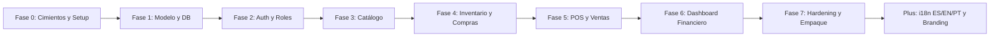
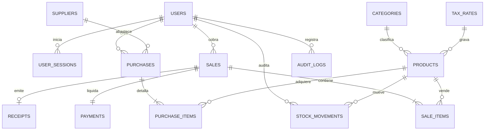
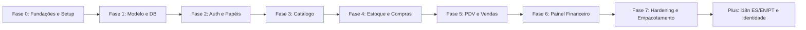

# Kanasta — Sistema de Gestión de Inventario, Caja y Ventas (POS)

<p align="center">
  
</p>

<p align="center">
  <strong>Sistema integral de punto de venta, inventario valorizado, compras y facturación de prueba para abastos y supermercados.</strong>
</p>

<p align="center">
  <a href="#-español">🇪🇸 <strong>Español</strong></a> &nbsp;|&nbsp;
  <a href="#-english">🇺🇸 <strong>English</strong></a> &nbsp;|&nbsp;
  <a href="#-português">🇧🇷 <strong>Português</strong></a>
</p>

<p align="center">
  
  
  
  
  
  
  
  
  
</p>

---

## 📌 Navegación Rápida / Quick Navigation / Navegação Rápida
- [🇪🇸 Español](#-español)
  - [1. Visión y Resumen del Proyecto](#1-visión-y-resumen-del-proyecto-es)
  - [2. Ejecución de Ingeniería con Agente de IA](#2-ejecución-de-ingeniería-con-agente-de-ia-antigravity-gemini-38-flash-high-es)
  - [3. Arquitectura del Sistema y Stack Tecnológico](#3-arquitectura-del-sistema-y-stack-tecnológico-es)
  - [4. Especificación Técnica de Ingeniería (KANASTA_PROJECT_SPEC.md)](#4-especificación-técnica-de-ingeniería-kanasta_project_specmd-es)
  - [5. Guía Operativa de Módulos (Cómo Funciona el MVP)](#5-guía-operativa-de-módulos-cómo-funciona-el-mvp-es)
  - [6. Guía de Instalación, Pruebas y Despliegue](#6-guía-de-instalación-pruebas-y-despliegue-es)
- [🇺🇸 English](#-english)
  - [1. Project Vision & Overview](#1-project-vision--overview-en)
  - [2. Engineering Execution by AI Agent (Antigravity - Gemini 3.8 Flash High)](#2-engineering-execution-by-ai-agent-antigravity-gemini-38-flash-high-en)
  - [3. System Architecture & Tech Stack](#3-system-architecture--tech-stack-en)
  - [4. Engineering Project Specification (KANASTA_PROJECT_SPEC.md)](#4-engineering-project-specification-kanasta_project_specmd-en)
  - [5. Operational Module Guide (How the MVP Works)](#5-operational-module-guide-how-the-mvp-works-en)
  - [6. Installation, Testing & Deployment Guide](#6-installation-testing--deployment-guide-en)
- [🇧🇷 Português](#-português)
  - [1. Visão Geral do Projeto](#1-visão-geral-do-projeto-pt)
  - [2. Execução de Engenharia pelo Agente de IA (Antigravity - Gemini 3.8 Flash High)](#2-execução-de-engenharia-pelo-agente-de-ia-antigravity-gemini-38-flash-high-pt)
  - [3. Arquitetura do Sistema e Stack Tecnológico](#3-arquitetura-do-sistema-e-stack-tecnológico-pt)
  - [4. Especificação de Engenharia do Projeto (KANASTA_PROJECT_SPEC.md)](#4-especificação-de-engenharia-do-projeto-kanasta_project_specmd-pt)
  - [5. Guia Operacional de Módulos (Como Funciona o MVP)](#5-guia-operacional-de-módulos-como-funciona-o-mvp-pt)
  - [6. Guia de Instalação, Testes e Implantação](#6-guia-de-instalação-testes-e-implantação-pt)

---

# 🇪🇸 Español

<a id="-español"></a>

## 1. Visión y Resumen del Proyecto (ES)
<a id="1-visión-y-resumen-del-proyecto-es"></a>

**Kanasta** es un sistema integral de escritorio para la administración de inventarios, compras, caja y ventas (POS) diseñado específicamente para abastos, bodegones, minimarkets y supermercados pequeños y medianos.

### Características Clave:
- **Punto de Venta (POS) Ágil:** Facturación rápida con teclado o lector de código de barras, buscador en tiempo real, cálculo de impuestos centralizado en el servidor y prevención estricta de stock negativo.
- **Transaccionalidad Atómica:** Toda venta, deducción de existencias, registro de pago y comprobante se procesa en una única transacción de base de datos (`BEGIN TRANSACTION ... COMMIT`). Si un paso falla, el sistema realiza rollback inmediato sin dejar ventas fantasmas ni descuadres de inventario.
- **Valoración por Costo Promedio Ponderado (CPP):** Cada recepción física de mercancía recalcula matemáticamente el costo de reposición de los productos en dólares (USD).
- **Control de Acceso Basado en Roles (RBAC):** Separación tajante entre `Admin` y `Cashier`. La API enmascara los costos unitarios y márgenes para cajeros (`AverageCost = null`).
- **Comprobantes Internos de Prueba:** Emisión e impresión de recibos térmicos no fiscales con advertencia explícita y desglose de IVA.
- **Dashboard Financiero en Tiempo Real:** Métricas de Ventas Netas, Costo de Mercancía Vendida (CMV), Margen Bruto ($ y %), pasivo fiscal de IVA e inventario valorizado, con exportación a CSV (RFC-4180).
- **Internacionalización Dinámica (i18n):** Interfaz totalmente traducible en tiempo de ejecución entre **Español**, **Inglés** y **Portugués**, preservando intactos los registros de base de datos introducidos por el usuario.

---

## 2. Ejecución de Ingeniería con Agente de IA: Antigravity (Gemini 3.8 Flash High) (ES)
<a id="2-ejecución-de-ingeniería-con-agente-de-ia-antigravity-gemini-38-flash-high-es"></a>

El desarrollo de este MVP de Kanasta se ejecutó bajo una metodología estricta de ingeniería asistida por Inteligencia Artificial. La especificación técnica completa se formuló en el archivo [`KANASTA_PROJECT_SPEC.md`](#4-especificación-técnica-de-ingeniería-kanasta_project_specmd-es), el cual sirvió como la **fuente de verdad inviolable** para el agente autónomo de codificación.

El agente **Antigravity**, impulsado por el modelo fundacional **Gemini 3.8 Flash High**, ejecutó la totalidad de la arquitectura y el código fuente paso a paso a través de las siguientes fases controladas:



### Hitos de la Ejecución Fase por Fase:
1. **Fase 0 (Cimientos y Decisiones):** Establecimiento del monorepo (`apps/desktop` y `services/api`), definición de convenciones, `.env.example`, y ratificación del Anexo A (Venezuela, moneda USD, comprobantes internos no fiscales).
2. **Fase 1 (Modelo de Dominio y Base de Datos):** Creación de 15 entidades con Entity Framework Core 8, tipos `NUMERIC(14,4)` y `NUMERIC(14,2)`, claves primarias UUID, restricciones `CHECK (stock_quantity >= 0)` y migraciones SQL idempotentes.
3. **Fase 2 (Autenticación y Roles):** Hashing con BCrypt (factor 11), tokens JWT Bearer, endpoint seguro de inicialización `/api/v1/auth/setup-admin`, auditoría de sesiones en `user_sessions` y blindaje contra cajeros.
4. **Fase 3 (Catálogo de Productos):** CRUD de categorías y productos con validación de SKU único, unidades base, tasas impositivas y enmascaramiento dinámico de costos para cajeros.
5. **Fase 4 (Inventario y Compras):** Gestión de proveedores, órdenes de compra con estado `DRAFT` y confirmación a `RECEIVED` estrictamente idempotente. Recálculo automático de CPP y Kardex append-only.
6. **Fase 5 (Terminal de Caja y Ventas):** Checkout atómico en PostgreSQL, snapshots inmutables de precios y costos, modal de cobro multidenominación en USD con cálculo de cambio, ticket térmico y anulación auditada con movimiento compensatorio `SALE_REVERSAL_IN`.
7. **Fase 6 (Dashboard e Informes Financieros):** Cálculo server-side de Ventas Netas, CMV, Margen Bruto ($ y %), alertas de stock bajo y exportador CSV con escape RFC-4180.
8. **Fase 7 (Endurecimiento de Seguridad y Empaquetado):** Implementación de `SecurityHeadersMiddleware`, limitador de tasa contra fuerza bruta (`AuthLimiter`: 15 req/30s), blindaje de excepciones con `traceId`, scripts de respaldo/restauración PostgreSQL (`pg_dump`/`pg_restore`) y configuración de Tauri 2.
9. **Internacionalización y Estética de Marca:** Adición del sistema de idiomas (ES/EN/PT) y estilización tipográfica basada en el activo de marca `Kanasta.jpg`.

---

## 3. Arquitectura del Sistema y Stack Tecnológico (ES)
<a id="3-arquitectura-del-sistema-y-stack-tecnológico-es"></a>

Kanasta utiliza un modelo cliente-servidor distribuido optimizado para entornos de red local (LAN) o servidores dedicados:

```
┌─────────────────────────────────┐       ┌─────────────────────────────────┐
│     Kanasta Desktop (Caja)      │       │     Kanasta Desktop (Admin)     │
│   Tauri 2 + React + TypeScript  │       │   Tauri 2 + React + TypeScript  │
└────────────────┬────────────────┘       └────────────────┬────────────────┘
                 │                                         │
                 └────────────────────┬────────────────────┘
                                      │ HTTPS / JWT Bearer
                           ┌──────────▼──────────┐
                           │   ASP.NET Core 8    │
                           │  Web API (Modular)  │
                           └──────────┬──────────┘
                                      │ EF Core 8 (Npgsql)
                           ┌──────────▼──────────┐
                           │  PostgreSQL 15+     │
                           │ Transacciones ACID  │
                           └─────────────────────┘
```

| Capa | Tecnologías | Justificación de Ingeniería |
|---|---|---|
| **Cliente de Escritorio** | **Tauri 2, React 18, TypeScript, Vite** | Consumo ultraligero de RAM (< 80 MB frente a los > 350 MB de Electron), binario nativo de Windows, seguridad basada en Webview2. |
| **Diseño y Estética** | **Vanilla CSS Moderno, Glassmorphism, Google Fonts** | UI oscura de alto contraste adaptada para entornos de iluminación exigentes en cajas de abastos. |
| **API de Negocio** | **ASP.NET Core (.NET 8) Web API** | Clean Architecture dividida en `Kanasta.Domain`, `Kanasta.Application`, `Kanasta.Infrastructure`, `Kanasta.Api` y `Kanasta.Tests`. Tipado estricto, alta concurrencia y validación centralizada. |
| **Persistencia** | **PostgreSQL 15+ / EF Core 8** | Integridad referencial fuerte, soporte de bloqueos transaccionales para evitar sobreventas concurrentes, tipos numéricos de alta precisión y claves UUID. |
| **Seguridad** | **BCrypt, JWT Bearer, Rate Limiting** | Sin almacenamiento de contraseñas en texto claro, sesiones auditadas, cabeceras seguras (`X-Content-Type-Options`, `X-Frame-Options`, `CSP`). |
| **Pruebas** | **xUnit (Backend: 58 tests), Vitest (Frontend: 32 tests)** | Cobertura 100% verde en reglas de negocio, integridad de DTOs, cálculos financieros y blindaje. |

---

## 4. Especificación Técnica de Ingeniería (KANASTA_PROJECT_SPEC.md) (ES)
<a id="4-especificación-técnica-de-ingeniería-kanasta_project_specmd-es"></a>

Esta sección integra los requerimientos fundamentales formulados en la especificación de ingeniería del producto:

### 4.1 Fórmulas Matemáticas y Financieras Obligatorias

1. **Valoración de Inventario:**
   $$\text{Valor del Inventario} = \sum (\text{StockQuantity} \times \text{AverageCost})$$
2. **Recálculo de Costo Promedio Ponderado (CPP / CMP):**
   Al confirmar la recepción física de una compra:
   $$\text{Nuevo Costo} = \frac{(\text{StockPrevio} \times \text{CostoPrevio}) + (\text{CantidadComprada} \times \text{CostoUnitarioCompra})}{\text{StockPrevio} + \text{CantidadComprada}}$$
   *(Si el stock previo es $\le 0$, el nuevo costo promedio adopta directamente el costo unitario de compra).*
3. **Ventas Netas Consolidadas:**
   $$\text{Ventas Netas} = \sum [(\text{Cantidad} \times \text{PrecioUnitario}) - \text{Descuento}]$$
   *(Excluye estrictamente impuestos indirectos y ventas con estado `Voided`).*
4. **Costo de Mercancía Vendida (CMV / COGS):**
   $$\text{CMV} = \sum (\text{CantidadVendida} \times \text{UnitCostSnapshot})$$
   *(Calculado a partir de los snapshots inmutables guardados en `sale_items`).*
5. **Margen Bruto Estimado:**
   $$\text{Margen Bruto (\$)} = \text{Ventas Netas} - \text{CMV}$$
   $$\text{Margen Bruto (\%)} = \left(\frac{\text{Margen Bruto}}{\text{Ventas Netas}}\right) \times 100 \quad (\text{si Ventas Netas} > 0)$$
6. **Segregación Fiscal:** El IVA recaudado ($\sum \text{TaxTotal}$) se trata como un pasivo fiscal y **nunca** como ingreso o ganancia del negocio.

### 4.2 Modelo de Datos Relacional (PostgreSQL)



#### Entidades Principales y Tipos de Datos:
- `products`: `id` (UUID PK), `sku` (VARCHAR 80 UNIQUE), `barcode` (VARCHAR 100 UNIQUE NULL), `name` (VARCHAR 180), `sale_price` (`NUMERIC(14,4)` CHECK $\ge 0$), `average_cost` (`NUMERIC(14,4)` CHECK $\ge 0$), `stock_quantity` (`NUMERIC(14,4)` CHECK $\ge 0$), `minimum_stock` (`NUMERIC(14,4)` NULL), `base_unit` (VARCHAR 20).
- `purchases`: `id` (UUID PK), `purchase_number` (VARCHAR 60 UNIQUE), `supplier_id` (FK), `status` (`DRAFT`, `RECEIVED`, `CANCELLED`), `subtotal`, `tax_total`, `total` (`NUMERIC(14,2)`).
- `stock_movements`: `id` (UUID PK), `product_id` (FK), `movement_type` (`PURCHASE_IN`, `SALE_OUT`, `SALE_REVERSAL_IN`, `MANUAL_IN`, `MANUAL_OUT`), `quantity_delta` (`NUMERIC(14,4)`), `quantity_after` (`NUMERIC(14,4)`), `unit_cost_snapshot` (`NUMERIC(14,4)`), `reason` (TEXT NULL), `created_at` (TIMESTAMPTZ).
- `sales`: `id` (UUID PK), `sale_number` (VARCHAR 60 UNIQUE), `cashier_id` (FK), `status` (`Completed`, `Voided`), `subtotal`, `tax_total`, `total` (`NUMERIC(14,2)`), `completed_at` (TIMESTAMPTZ).
- `sale_items`: `id` (UUID PK), `sale_id` (FK), `product_id` (FK), `sku_snapshot`, `product_name_snapshot`, `unit_snapshot`, `quantity` (`NUMERIC(14,4)` CHECK $> 0$), `unit_price`, `unit_cost_snapshot`, `tax_rate_snapshot`, `tax_amount`, `line_total` (`NUMERIC(14,2)`).
- `receipts`: `id` (UUID PK), `sale_id` (FK UNIQUE), `document_number` (VARCHAR 80 UNIQUE), `document_type` (`INTERNAL_TEST_RECEIPT`), `business_snapshot` (JSONB con advertencia no fiscal).

### 4.3 Criterios de Aceptación Globales
- **Anti-Stock Negativo:** Queda absolutamente prohibido registrar una venta que resulte en saldo de inventario $< 0$.
- **Idempotencia en Recepción:** Una compra solo puede recibirse una vez. Intentos subsecuentes son rechazados con `BusinessRuleException`.
- **Inmutabilidad Histórica:** La alteración de precios o costos en el catálogo nunca modifica los snapshots de ventas pasadas.
- **Auditoría Append-Only:** No se eliminan registros históricos de Kardex ni de ventas. Las correcciones se realizan con movimientos inversos justificados.

---

## 5. Guía Operativa de Módulos (Cómo Funciona el MVP) (ES)
<a id="5-guía-operativa-de-módulos-cómo-funciona-el-mvp-es"></a>

### Módulo 1: Autenticación, Roles y Auditoría de Sesiones
1. **Primer Arranque (Setup Admin):** Cuando la base de datos está vacía, el sistema detecta la ausencia de usuarios y muestra la pantalla interactiva de configuración para crear el primer Administrador Maestro (`/api/v1/auth/setup-admin`).
2. **Inicio de Sesión:** Admite autenticación segura por correo y contraseña. Cada intento (exitoso o fallido) queda registrado en `user_sessions`.
3. **Bloqueo por Inactividad:** Los administradores pueden desactivar usuarios (`is_active = false`), impidiendo cualquier inicio de sesión posterior de forma inmediata.

### Módulo 2: Catálogo de Productos y Categorías
- **Búsqueda en Tiempo Real:** Filtrado instantáneo por nombre, SKU o código de barras.
- **Simulador de Escáner:** Permite probar lectores de códigos de barras ópticos en la terminal de escritorio.
- **Confidencialidad de Costos:** Para cajeros, los costos de adquisición y márgenes aparecen como `---` y la API retorna `AverageCost: null`.

### Módulo 3: Compras y Recepción Idempotente
1. El Administrador registra una orden de compra en estado `DRAFT` seleccionando un proveedor y agregando productos y costos.
2. Al recibir la mercancía físicamente en almacén, el usuario presiona **"Recibir Mercancía"**.
3. El sistema valida la orden, cambia el estado a `RECEIVED`, incrementa el stock de cada producto, calcula el nuevo Costo Promedio Ponderado y genera el movimiento de Kardex `PURCHASE_IN`.

### Módulo 4: Terminal de Caja (POS) y Cobro
1. El cajero busca el producto o escanea su código. El sistema verifica en vivo la existencia física.
2. Si el cajero intenta ingresar una cantidad mayor a la disponible, el sistema bloquea la adición con una alerta visible.
3. Al pulsar **"Cobrar"**, se abre el modal de pagos con opciones de Efectivo, Tarjeta, Transferencia u Otro, botones rápidos de billetes en USD ($5, $10, $20, $50, $100) y cálculo automático de cambio.
4. Tras confirmarse la transacción atómica, se despliega el ticket térmico de prueba, listo para imprimir con `window.print()`.

### Módulo 5: Inventario y Kardex Físico
- **Monitor de Stock:** Códigos de color automáticos (Verde: stock óptimo; Amarillo: advertencia de stock mínimo; Rojo: agotado).
- **Ajustes Manuales Justificados:** Permite registrar mermas (`MANUAL_OUT`) o ingresos excepcionales (`MANUAL_IN`), exigiendo obligatoriamente un motivo en texto y validando que no se genere saldo negativo.
- **Kardex Detallado:** Trazabilidad completa que muestra fecha UTC, usuario responsable, tipo de movimiento, cantidad delta y saldo resultante.

### Módulo 6: Dashboard Financiero y Reportes
- **KPIs Consolidados:** Tarjetas interactivas de Ventas Netas, CMV, Utilidad Bruta, Margen %, Impuestos e Inventario Valorizado.
- **Desglose Multidimensional:** Filtro por cajero, ranking de productos más vendidos y desglose por método de pago.
- **Exportación Contable:** Botón para descargar el reporte detallado de ventas en formato `.csv` compatible con Excel y software contable.

### Módulo 7: Internacionalización (i18n)
- Selector flotante en la cabecera que permite alternar entre **Español (ES)**, **English (EN)** y **Português (PT)**.
- Persistencia local en `localStorage` que conserva la preferencia del usuario entre reinicios de la aplicación.
- Los datos de negocio creados dinámicamente en base de datos (nombres de productos, notas de proveedores) se mantienen en su idioma original sin alteración.

---

## 6. Guía de Instalación, Pruebas y Despliegue (ES)
<a id="6-guía-operativa-de-instalación-pruebas-y-despliegue-es"></a>

### 6.1 Prerrequisitos
- **.NET 8 SDK** (versión 8.0.x o superior).
- **Node.js** (versión 18 LTS o 20 LTS) y **npm**.
- **PostgreSQL 15+** (o SQLite para modo desarrollo local).
- **Rust y Cargo** (opcional para desarrollo web; requerido para compilar el instalador nativo de Tauri 2).

### 6.2 Configuración Inicial
1. Clonar el repositorio y copiar las variables de entorno:
   ```bash
   cp .env.example .env
   ```
2. Configurar la cadena de conexión en `.env`:
   ```env
   ConnectionStrings__DefaultConnection="Host=localhost;Port=5432;Database=kanasta_db;Username=postgres;Password=tu_password"
   Jwt__SecretKey="TuClaveSecretaSuperSeguraDeMasDe32Caracteres"
   ```

### 6.3 Ejecución del Backend (.NET 8 Web API)
```bash
# Compilar la solución
dotnet build services/api/Kanasta.sln

# Ejecutar pruebas unitarias e integración (58 tests)
dotnet test services/api/Kanasta.sln

# Iniciar la API
dotnet run --project services/api/Kanasta.Api
```
*La API estará disponible en `http://localhost:5000` con Swagger UI en `/swagger`.*

### 6.4 Ejecución del Frontend de Escritorio (React + Tauri)
```bash
cd apps/desktop

# Instalar dependencias
npm install

# Ejecutar pruebas automatizadas (32 tests)
npm run test

# Iniciar servidor de desarrollo Vite
npm run dev

# Compilar para producción
npm run build
```

### 6.5 Compilación del Instalador Nativo de Windows (Tauri 2)
```bash
cd apps/desktop
npm run tauri:build
```
*Genera instaladores `.msi` y `.exe` (NSIS) listos para terminales de punto de venta.*

### 6.6 Copias de Seguridad y Restauración de Base de Datos
- **Respaldar PostgreSQL:**
  ```powershell
  powershell -ExecutionPolicy Bypass -File database/scripts/backup-postgres.ps1
  ```
- **Restaurar PostgreSQL:**
  ```powershell
  powershell -ExecutionPolicy Bypass -File database/scripts/restore-postgres.ps1 -BackupFile ruta_al_backup.dump
  ```

---
---

# 🇺🇸 English

<a id="-english"></a>

## 1. Project Vision & Overview (EN)
<a id="1-project-vision--overview-en"></a>

**Kanasta** is a full-featured desktop Point of Sale (POS), inventory management, and purchasing system engineered specifically for grocery stores, minimarkets, and small-to-medium supermarkets.

### Core Capabilities:
- **Fast-Paced Point of Sale (POS):** Rapid cashier checkout with barcode reader support, real-time product search, server-side tax calculations, and strict anti-negative stock policy.
- **Atomic Transactions:** All sales, stock decrements, payment entries, and test receipts are processed within a single database transaction (`BEGIN TRANSACTION ... COMMIT`). Any unexpected failure triggers an immediate rollback with zero orphaned records or stock drift.
- **Weighted-Average Cost Valuation (WAC / CPP):** Each physical goods receipt recalculates the unit replacement cost in USD.
- **Strict Role-Based Access Control (RBAC):** Rigorous boundary between `Admin` and `Cashier`. Unit costs and profit margins are masked on the server for cashiers (`AverageCost = null`).
- **Internal Test Receipts:** Thermal receipt printing with clear non-fiscal evaluation disclaimers and itemized tax breakdowns.
- **Real-Time Financial Dashboard:** Live KPIs for Net Sales, Cost of Goods Sold (COGS), Gross Margin ($ and %), VAT tax liability, and valued inventory, complete with RFC-4180 CSV export.
- **Dynamic Internationalization (i18n):** Runtime language toggle between **Spanish**, **English**, and **Portuguese**, with client-side persistence while preserving user-entered database records.

---

## 2. Engineering Execution by AI Agent: Antigravity (Gemini 3.8 Flash High) (EN)
<a id="2-engineering-execution-by-ai-agent-antigravity-gemini-38-flash-high-en"></a>

The development of the Kanasta MVP followed a disciplined AI-assisted engineering methodology. The detailed engineering specifications were defined in [`KANASTA_PROJECT_SPEC.md`](#4-engineering-project-specification-kanasta_project_specmd-en), serving as the **single source of truth** for the coding agent.

The **Antigravity** autonomous coding agent, powered by Google's **Gemini 3.8 Flash High** foundational model, executed the architecture and full implementation phase-by-phase across the planned stages:

```mermaid
flowchart LR
    P0[Phase 0: Foundations & Setup] --> P1[Phase 1: Domain & DB]
    P1 --> P2[Phase 2: Auth & Roles]
    P2 --> P3[Phase 3: Catalog]
    P3 --> P4[Phase 4: Inventory & Purchasing]
    P4 --> P5[Phase 5: POS & Checkout]
    P5 --> P6[Phase 6: Financial Dashboard]
    P6 --> P7[Phase 7: Hardening & Packaging]
    P7 --> P8[Plus: i18n ES/EN/PT & Branding]
```



### Phase-by-Phase Execution Milestones:
1. **Phase 0 (Foundations & Decisions):** Monorepo structure (`apps/desktop` and `services/api`), standard conventions, `.env.example`, and ratification of Annex A (Venezuela, USD commercial reference, non-fiscal internal receipts).
2. **Phase 1 (Domain Model & Database):** 15 EF Core 8 entities, `NUMERIC(14,4)` and `NUMERIC(14,2)` precision, UUID primary keys, PostgreSQL `CHECK (stock_quantity >= 0)` constraints, and idempotent migration scripts.
3. **Phase 2 (Authentication & Roles):** BCrypt password hashing (work factor 11), JWT Bearer tokens, secure initialization endpoint `/api/v1/auth/setup-admin`, login auditing in `user_sessions`, and cashier access shielding.
4. **Phase 3 (Product Catalog):** Categories and products CRUD with unique SKU validation, base units, tax rates, and dynamic cashier cost masking.
5. **Phase 4 (Inventory & Purchases):** Supplier directory, purchase orders with `DRAFT` to `RECEIVED` transition, strictly idempotent goods receipt, automatic WAC calculation, and append-only Kardex trail.
6. **Phase 5 (POS Terminal & Sales):** Atomic checkout in PostgreSQL, immutable price/cost snapshots, USD multi-denomination cash change calculator, thermal receipt modal, and audited sale voiding with `SALE_REVERSAL_IN` stock restoration.
7. **Phase 6 (Financial Dashboard & Reporting):** Server-side Net Sales, COGS, Gross Margin ($ and %), low-stock alerts, and RFC-4180 CSV export.
8. **Phase 7 (Security Hardening & Packaging):** `SecurityHeadersMiddleware`, brute-force rate limiter (`AuthLimiter`: 15 req/30s), exception shielding with `traceId`, automated PostgreSQL backup/restore scripts (`pg_dump`/`pg_restore`), and Tauri 2 packaging.
9. **Internationalization & Brand Identity:** Runtime language toggle (ES/EN/PT) and typography styling inspired by the brand asset `Kanasta.jpg`.

---

## 3. System Architecture & Tech Stack (EN)
<a id="3-system-architecture--tech-stack-en"></a>

Kanasta utilizes a distributed client-server architecture engineered for local networks (LAN) or secure servers:

```
┌─────────────────────────────────┐       ┌─────────────────────────────────┐
│     Kanasta Desktop (Cashier)   │       │     Kanasta Desktop (Admin)     │
│   Tauri 2 + React + TypeScript  │       │   Tauri 2 + React + TypeScript  │
└────────────────┬────────────────┘       └────────────────┬────────────────┘
                 │                                         │
                 └────────────────────┬────────────────────┘
                                      │ HTTPS / JWT Bearer
                           ┌──────────▼──────────┐
                           │   ASP.NET Core 8    │
                           │  Web API (Modular)  │
                           └──────────┬──────────┘
                                      │ EF Core 8 (Npgsql)
                           ┌──────────▼──────────┐
                           │  PostgreSQL 15+     │
                           │  ACID Transactions  │
                           └─────────────────────┘
```

| Layer | Technologies | Engineering Rationale |
|---|---|---|
| **Desktop App** | **Tauri 2, React 18, TypeScript, Vite** | Ultra-low RAM usage (< 80 MB vs > 350 MB on Electron), native Windows binary, secure Webview2 isolation. |
| **Styling & Aesthetics** | **Vanilla CSS, Glassmorphism, Google Fonts** | High-contrast dark theme optimized for POS cash register lighting environments. |
| **Backend API** | **ASP.NET Core (.NET 8) Web API** | Clean Architecture structured across `Kanasta.Domain`, `Kanasta.Application`, `Kanasta.Infrastructure`, `Kanasta.Api`, and `Kanasta.Tests`. Strong typing and transactional safety. |
| **Database** | **PostgreSQL 15+ / EF Core 8** | Strong referential integrity, row locking to prevent concurrent overselling, high-precision numeric types, and UUIDs. |
| **Security** | **BCrypt, JWT Bearer, Rate Limiting** | Zero plaintext passwords, audited sessions, security headers (`X-Content-Type-Options`, `X-Frame-Options`, `CSP`). |
| **Testing** | **xUnit (Backend: 58 tests), Vitest (Frontend: 32 tests)** | 100% passing tests covering business logic, DTO integrity, financial formulas, and security hardening. |

---

## 4. Engineering Project Specification (KANASTA_PROJECT_SPEC.md) (EN)
<a id="4-engineering-project-specification-kanasta_project_specmd-en"></a>

### 4.1 Mandatory Mathematical & Financial Formulas

1. **Inventory Valuation:**
   $$\text{Inventory Value} = \sum (\text{StockQuantity} \times \text{AverageCost})$$
2. **Weighted-Average Cost (WAC / CPP):**
   Calculated upon confirming physical goods receipt:
   $$\text{New Cost} = \frac{(\text{PrevStock} \times \text{PrevCost}) + (\text{PurchasedQty} \times \text{PurchaseUnitCost})}{\text{PrevStock} + \text{PurchasedQty}}$$
   *(If previous stock is $\le 0$, the new average cost is set directly to the purchase unit cost).*
3. **Consolidated Net Sales:**
   $$\text{Net Sales} = \sum [(\text{Quantity} \times \text{UnitPrice}) - \text{Discount}]$$
   *(Strictly excludes indirect taxes and `Voided` sales).*
4. **Cost of Goods Sold (COGS / CMV):**
   $$\text{COGS} = \sum (\text{SoldQuantity} \times \text{UnitCostSnapshot})$$
   *(Derived from the immutable snapshots saved on `sale_items`).*
5. **Estimated Gross Margin:**
   $$\text{Gross Margin (\$)} = \text{Net Sales} - \text{COGS}$$
   $$\text{Gross Margin (\%)} = \left(\frac{\text{Gross Margin}}{\text{Net Sales}}\right) \times 100 \quad (\text{if Net Sales} > 0)$$
6. **Tax Segregation:** Collected VAT ($\sum \text{TaxTotal}$) is classified as a tax liability and **never** recognized as company revenue or gross profit.

### 4.2 Relational Data Model (PostgreSQL)
- `products`: UUID PK, unique SKU, optional unique barcode, unit price (`NUMERIC(14,4)` CHECK $\ge 0$), average cost (`NUMERIC(14,4)` CHECK $\ge 0$), stock quantity (`NUMERIC(14,4)` CHECK $\ge 0$), base unit.
- `purchases`: UUID PK, unique purchase number, supplier FK, status (`DRAFT`, `RECEIVED`, `CANCELLED`), subtotal, tax, total.
- `stock_movements`: Append-only records with product FK, movement type (`PURCHASE_IN`, `SALE_OUT`, `SALE_REVERSAL_IN`, `MANUAL_IN`, `MANUAL_OUT`), quantity delta, balance after, cost snapshot, mandatory reason, timestamp.
- `sales`: UUID PK, unique sale number, cashier FK, status (`Completed`, `Voided`), subtotal, tax, total, completion timestamp.
- `sale_items`: UUID PK, sale FK, product FK, snapshots for SKU, name, unit, unit price, unit cost, tax rate, line total.
- `receipts`: UUID PK, sale FK UNIQUE, unique document number, document type (`INTERNAL_TEST_RECEIPT`), JSONB snapshot with non-fiscal disclaimer.

### 4.3 Global Acceptance Criteria
- **Strict Anti-Negative Stock:** No transaction can ever drive inventory balances below zero.
- **Idempotent Reception:** A purchase order can only be received once. Re-receipt requests return `BusinessRuleException`.
- **Historical Immutability:** Changing prices or tax rates in the catalog will never alter past sale lines.
- **Append-Only Auditing:** No deletion of transactions or Kardex entries. Corrections require audited reverse entries.

---

## 5. Operational Module Guide (How the MVP Works) (EN)
<a id="5-operational-module-guide-how-the-mvp-works-en"></a>

### Module 1: Auth, Roles & Session Auditing
1. **Initial Setup (Admin Initialization):** On a fresh installation, the system prompts for the Master Admin credentials (`/api/v1/auth/setup-admin`).
2. **Login & Session Tracking:** Users authenticate with email and password. Every login attempt is tracked in `user_sessions`.
3. **Account Deactivation:** Admins can deactivate accounts (`is_active = false`), revoking access immediately.

### Module 2: Catalog & Categories
- **Live Search & Filter:** Instant search by product name, SKU, or barcode.
- **Barcode Scanner Simulator:** Integrated utility to verify optical scanner inputs on desktop terminals.
- **Cashier Privacy:** For cashier users, acquisition costs display as `---` and the API omits cost fields.

### Module 3: Purchasing & Idempotent Reception
1. Admins create purchase orders in `DRAFT` status with chosen suppliers, quantities, and unit costs.
2. Upon warehouse delivery, clicking **"Receive Goods"** transitions the order to `RECEIVED`.
3. The system atomically increases stock, recalculates the Weighted-Average Cost, and logs a `PURCHASE_IN` movement.

### Module 4: POS Terminal & Checkout
1. Cashiers scan or search items with real-time stock checks.
2. If requested quantities exceed available inventory, the addition is blocked with a visual alert.
3. Clicking **"Pay / Checkout"** opens the payment modal (Cash, Card, Bank Transfer, Other) with quick USD bills ($5, $10, $20, $50, $100) and change calculation.
4. On confirmation, the system executes an atomic transaction and generates a thermal test receipt printable via `window.print()`.

### Module 5: Inventory & Physical Kardex
- **Stock Health Badges:** Color-coded status (Green: healthy; Yellow: low stock; Red: out of stock).
- **Justified Manual Adjustments:** Stock corrections (`MANUAL_IN` or `MANUAL_OUT`) require an explicit reason and block negative balances.
- **Detailed Kardex:** Full chronological trail detailing timestamp, actor, delta, and resulting balance.

### Module 6: Financial Dashboard & Analytics
- **Live Business KPIs:** Real-time metrics for Net Sales, COGS, Gross Profit, Margin %, VAT, and Valued Stock.
- **Analytical Breakdowns:** Performance per cashier, top-selling items, and payment method distribution.
- **Accounting Export:** One-click CSV export formatted to RFC-4180 standards.

### Module 7: Multi-Language (i18n)
- Header language toggle supporting **Spanish (ES)**, **English (EN)**, and **Portuguese (PT)**.
- Preferences persist in `localStorage` across application reloads.
- Dynamic business records stored in the database remain untouched in their original language.

---

## 6. Installation, Testing & Deployment Guide (EN)
<a id="6-installation-testing--deployment-guide-en"></a>

### 6.1 Prerequisites
- **.NET 8 SDK** (version 8.0.x or higher).
- **Node.js** (v18 LTS or v20 LTS) & **npm**.
- **PostgreSQL 15+** (or SQLite for local zero-config mode).
- **Rust & Cargo** (required only for building native Tauri 2 desktop binaries).

### 6.2 Environment Setup
1. Copy the environment configuration:
   ```bash
   cp .env.example .env
   ```
2. Configure your connection string in `.env`:
   ```env
   ConnectionStrings__DefaultConnection="Host=localhost;Port=5432;Database=kanasta_db;Username=postgres;Password=your_password"
   Jwt__SecretKey="YourSuperSecretKeyWithMoreThan32CharactersLong"
   ```

### 6.3 Running the Backend (.NET 8 Web API)
```bash
# Build the solution
dotnet build services/api/Kanasta.sln

# Run unit & integration test suites (58 tests)
dotnet test services/api/Kanasta.sln

# Start the API server
dotnet run --project services/api/Kanasta.Api
```
*API runs at `http://localhost:5000` with Swagger documentation at `/swagger`.*

### 6.4 Running the Desktop Frontend (React + Tauri)
```bash
cd apps/desktop

# Install npm dependencies
npm install

# Run automated frontend test suites (32 tests)
npm run test

# Launch Vite dev server
npm run dev

# Build production bundle
npm run build
```

### 6.5 Building the Native Windows Installer (Tauri 2)
```bash
cd apps/desktop
npm run tauri:build
```
*Generates production `.msi` and `.exe` (NSIS) installers.*

### 6.6 Database Backup & Restore
- **Backup PostgreSQL:**
  ```powershell
  powershell -ExecutionPolicy Bypass -File database/scripts/backup-postgres.ps1
  ```
- **Restore PostgreSQL:**
  ```powershell
  powershell -ExecutionPolicy Bypass -File database/scripts/restore-postgres.ps1 -BackupFile path_to_backup.dump
  ```

---
---

# 🇧🇷 Português

<a id="-português"></a>

## 1. Visão Geral do Projeto (PT)
<a id="1-visão-geral-do-projeto-pt"></a>

**Kanasta** é um sistema completo de desktop para gerenciamento de estoque, compras, frente de caixa e vendas (PDV / POS), desenvolvido especialmente para mercearias, minimercados e supermercados de pequeno e médio porte.

### Principais Recursos:
- **Ponto de Venda (PDV) Ágil:** Caixa rápido com leitor de código de barras, busca em tempo real, cálculo de impostos centralizado no servidor e bloqueio rigoroso de estoque negativo.
- **Transacionalidade Atômica:** Cada venda, baixa de estoque, pagamento e comprovante é processado em uma única transação no banco de dados (`BEGIN TRANSACTION ... COMMIT`). Falhas inesperadas disparam reversão (rollback) imediata, sem registros órfãos ou inconsistências.
- **Avaliação por Custo Médio Ponderado (CMP / CPP):** O recebimento de mercadorias recalcula matematicamente o custo unitário em dólares (USD).
- **Controle de Acesso por Papéis (RBAC):** Separação estrita entre `Admin` e `Cashier` (Operador de Caixa). A API mascara custos e margens de lucro para caixas (`AverageCost = null`).
- **Comprovantes Internos de Teste:** Impressão de recibos térmicos não fiscais com aviso explícito de ambiente de avaliação e discriminação de impostos.
- **Painel Financeiro em Tempo Real:** Indicadores de Vendas Líquidas, Custo da Mercadoria Vendida (CMV), Margem Bruta ($ e %), passivo de IVA e estoque valorizado, com exportação para CSV (RFC-4180).
- **Internacionalização Dinâmica (i18n):** Alternância instantânea de idioma entre **Espanhol**, **Inglês** e **Português**, com persistência local e preservação intacta dos dados inseridos no banco.

---

## 2. Execução de Engenharia pelo Agente de IA: Antigravity (Gemini 3.8 Flash High) (PT)
<a id="2-execução-de-engenharia-pelo-agente-de-ia-antigravity-gemini-38-flash-high-pt"></a>

O desenvolvimento do MVP do Kanasta seguiu uma metodologia disciplinada de engenharia guiada por Inteligência Artificial. A especificação técnica completa foi formalizada no arquivo [`KANASTA_PROJECT_SPEC.md`](#4-especificação-de-engenharia-do-projeto-kanasta_project_specmd-pt), que serviu como **fonte única da verdade** para o agente de codificação.

O agente autônomo **Antigravity**, alimentado pelo modelo **Gemini 3.8 Flash High** da Google, executou toda a arquitetura e implementação código a código em etapas controladas:



### Marcos da Execução Fase a Fase:
1. **Fase 0 (Fundações e Decisões):** Estrutura do monorepo (`apps/desktop` e `services/api`), convenções, `.env.example` e ratificação do Anexo A (Venezuela, referência comercial em USD, comprovantes de teste não fiscais).
2. **Fase 1 (Modelo de Domínio e Banco de Dados):** 15 entidades EF Core 8, tipos `NUMERIC(14,4)` e `NUMERIC(14,2)`, chaves primárias UUID, restrições `CHECK (stock_quantity >= 0)` e scripts de migração idempotentes.
3. **Fase 2 (Autenticação e Papéis):** Hashing com BCrypt (fator 11), tokens JWT Bearer, endpoint seguro `/api/v1/auth/setup-admin`, auditoria de sessões em `user_sessions` e proteção de rotas restritas.
4. **Fase 3 (Catálogo de Produtos):** CRUD de categorias e produtos com validação de SKU único, unidades base, alíquotas fiscais e mascaramento dinâmico de custos para caixas.
5. **Fase 4 (Estoque e Compras):** Gestão de fornecedores, ordens de compra em `DRAFT` e confirmação para `RECEIVED` estritamente idempotente. Recálculo automático de CMP e Kardex append-only.
6. **Fase 5 (Frente de Caixa e Vendas):** Checkout atômico no PostgreSQL, snapshots imutáveis de preços/custos, calculadora de troco em USD, comprovante térmico e cancelamento auditado com `SALE_REVERSAL_IN`.
7. **Fase 6 (Painel Financeiro e Relatórios):** Cálculo no servidor de Vendas Líquidas, CMV, Margem Bruta ($ e %), alertas de estoque baixo e exportador CSV com escape RFC-4180.
8. **Fase 7 (Endurecimento de Segurança e Empacotamento):** `SecurityHeadersMiddleware`, limitador de taxa contra força bruta (`AuthLimiter`: 15 req/30s), tratamento seguro de exceções com `traceId`, scripts de backup/restauração (`pg_dump`/`pg_restore`) e configuração do Tauri 2.
9. **Internacionalização e Identidade Visual:** Suporte a múltiplos idiomas (ES/EN/PT) e estilização baseada na logo oficial `Kanasta.jpg`.

---

## 3. Arquitetura do Sistema e Stack Tecnológico (PT)
<a id="3-arquitetura-do-sistema-e-stack-tecnológico-pt"></a>

O Kanasta adota uma arquitetura cliente-servidor distribuída ideal para redes locais (LAN) ou servidores dedicados:

```
┌─────────────────────────────────┐       ┌─────────────────────────────────┐
│     Kanasta Desktop (Caixa)     │       │     Kanasta Desktop (Admin)     │
│   Tauri 2 + React + TypeScript  │       │   Tauri 2 + React + TypeScript  │
└────────────────┬────────────────┘       └────────────────┬────────────────┘
                 │                                         │
                 └────────────────────┬────────────────────┘
                                      │ HTTPS / JWT Bearer
                           ┌──────────▼──────────┐
                           │   ASP.NET Core 8    │
                           │  Web API (Modular)  │
                           └──────────┬──────────┘
                                      │ EF Core 8 (Npgsql)
                           ┌──────────▼──────────┐
                           │  PostgreSQL 15+     │
                           │  Transações ACID    │
                           └─────────────────────┘
```

| Camada | Tecnologias | Justificativa de Engenharia |
|---|---|---|
| **App Desktop** | **Tauri 2, React 18, TypeScript, Vite** | Consumo ultrabaixo de memória (< 80 MB vs > 350 MB no Electron), binário nativo para Windows, segurança Webview2. |
| **Design e Estilo** | **Vanilla CSS, Glassmorphism, Google Fonts** | Tema escuro de alto contraste desenvolvido para terminais de caixa em iluminação comercial intensa. |
| **API de Negócios** | **ASP.NET Core (.NET 8) Web API** | Clean Architecture dividida em `Kanasta.Domain`, `Kanasta.Application`, `Kanasta.Infrastructure`, `Kanasta.Api` e `Kanasta.Tests`. Tipagem estrita e transações atômicas. |
| **Banco de Dados** | **PostgreSQL 15+ / EF Core 8** | Integridade referencial robusta, bloqueios para evitar venda concorrente acima do estoque, precisão decimal elevada e UUIDs. |
| **Segurança** | **BCrypt, JWT Bearer, Rate Limiting** | Sem senhas em texto puro, sessões auditadas, cabeçalhos HTTP seguros (`X-Content-Type-Options`, `X-Frame-Options`, `CSP`). |
| **Testes** | **xUnit (Backend: 58 testes), Vitest (Frontend: 32 testes)** | 100% dos testes aprovados cobrindo regras de negócio, integridade de DTOs, cálculos financeiros e segurança. |

---

## 4. Especificação de Engenharia do Projeto (KANASTA_PROJECT_SPEC.md) (PT)
<a id="4-especificação-de-engenharia-do-projeto-kanasta_project_specmd-pt"></a>

### 4.1 Fórmulas Matemáticas e Financeiras Mandatórias

1. **Valor do Estoque:**
   $$\text{Valor do Estoque} = \sum (\text{StockQuantity} \times \text{AverageCost})$$
2. **Custo Médio Ponderado (CMP / CPP):**
   Calculado ao confirmar o recebimento físico de uma compra:
   $$\text{Novo Custo} = \frac{(\text{EstoqueAnterior} \times \text{CustoAnterior}) + (\text{QtdComprada} \times \text{CustoUnitarioCompra})}{\text{EstoqueAnterior} + \text{QtdComprada}}$$
   *(Se o estoque anterior for $\le 0$, o novo custo médio adota diretamente o custo unitário da compra).*
3. **Vendas Líquidas Consolidadas:**
   $$\text{Vendas Líquidas} = \sum [(\text{Quantidade} \times \text{PrecoUnitario}) - \text{Desconto}]$$
   *(Exclui estritamente tributos indiretos e vendas com status `Voided`).*
4. **Custo da Mercadoria Vendida (CMV / COGS):**
   $$\text{CMV} = \sum (\text{QuantidadeVendida} \times \text{UnitCostSnapshot})$$
   *(Calculado com base nos snapshots imutáveis salvos em `sale_items`).*
5. **Margem Bruta Estimada:**
   $$\text{Margem Bruta (\$)} = \text{Vendas Líquidas} - \text{CMV}$$
   $$\text{Margem Bruta (\%)} = \left(\frac{\text{Margem Bruta}}{\text{Vendas Líquidas}}\right) \times 100 \quad (\text{se Vendas Líquidas} > 0)$$
6. **Segregação Tributária:** O IVA arrecadado ($\sum \text{TaxTotal}$) é classificado como obrigação fiscal e **nunca** como receita ou lucro da empresa.

### 4.2 Modelo de Dados Relacional (PostgreSQL)
- `products`: Chave primária UUID, SKU exclusivo, código de barras opcional exclusivo, preço (`NUMERIC(14,4)` CHECK $\ge 0$), custo médio (`NUMERIC(14,4)` CHECK $\ge 0$), saldo de estoque (`NUMERIC(14,4)` CHECK $\ge 0$), unidade base.
- `purchases`: UUID PK, número de compra exclusivo, FK fornecedor, status (`DRAFT`, `RECEIVED`, `CANCELLED`), subtotal, imposto, total.
- `stock_movements`: Registros append-only com FK de produto, tipo (`PURCHASE_IN`, `SALE_OUT`, `SALE_REVERSAL_IN`, `MANUAL_IN`, `MANUAL_OUT`), delta de quantidade, saldo resultante, snapshot de custo, motivo obrigatório e data.
- `sales`: UUID PK, número de venda exclusivo, FK operador de caixa, status (`Completed`, `Voided`), subtotal, imposto, total, data de conclusão.
- `sale_items`: UUID PK, FK venda, FK produto, snapshots de SKU, nome, unidade, preço, custo, imposto e total da linha.
- `receipts`: UUID PK, FK venda UNIQUE, número do documento exclusivo, tipo (`INTERNAL_TEST_RECEIPT`), JSONB com aviso não fiscal.

### 4.3 Critérios Globais de Aceitação
- **Bloqueio de Estoque Negativo:** Nenhuma operação pode deixar o estoque abaixo de zero.
- **Idempotência no Recebimento:** Uma compra só pode ser recebida uma única vez. Tentativas repetidas geram `BusinessRuleException`.
- **Imutabilidade Histórica:** Alterar preços ou alíquotas no catálogo não altera o histórico de vendas já concluídas.
- **Auditoria Append-Only:** Registros de Kardex e vendas não são deletados; ajustes exigem contrapartidas auditadas.

---

## 5. Guia Operacional de Módulos (Como Funciona o MVP) (PT)
<a id="5-guia-operacional-de-módulos-como-funciona-o-mvp-pt"></a>

### Módulo 1: Autenticação, Papéis e Auditoria
1. **Configuração Inicial (Setup Admin):** Em instalação limpa, a tela solicita a criação do Administrador Principal (`/api/v1/auth/setup-admin`).
2. **Login e Registro de Sessões:** Acesso seguro com e-mail e senha. Cada tentativa é registrada em `user_sessions`.
3. **Desativação de Contas:** Administradores podem suspender usuários (`is_active = false`), bloqueando novos logins instantaneamente.

### Módulo 2: Catálogo de Produtos e Categorias
- **Busca em Tempo Real:** Filtro rápido por nome, SKU ou código de barras.
- **Simulador de Leitor Óptico:** Ferramenta integrada para testar entradas de leitores de código de barras.
- **Privacidade do Operador de Caixa:** Para o perfil de caixa, custos e margens são exibidos como `---` e a API omite os custos.

### Módulo 3: Compras e Recebimento Físico
1. O Administrador cadastra pedidos de compra em status `DRAFT` indicando fornecedor, itens e custos.
2. Na entrega física no depósito, o usuário clica em **"Receber Mercadoria"**.
3. O sistema valida o pedido, altera para `RECEIVED`, incrementa o estoque, recalcula o Custo Médio Ponderado e registra o movimento `PURCHASE_IN`.

### Módulo 4: Frente de Caixa (PDV) e Pagamento
1. O caixa busca ou escaneia o item, com checagem de saldo em tempo real.
2. A tentativa de adicionar quantidade maior que a disponível é bloqueada com aviso visual.
3. Clicar em **"Cobrar"** abre a modal de pagamento (Dinheiro, Cartão, Transferência, Outro), com atalhos de notas em USD ($5, $10, $20, $50, $100) e cálculo automático de troco.
4. Após a confirmação da transação atômica, o comprovante térmico é exibido, pronto para impressão com `window.print()`.

### Módulo 5: Estoque e Kardex
- **Indicadores de Saúde:** Cores automáticas (Verde: estoque saudável; Amarelo: estoque mínimo; Vermelho: esgotado).
- **Ajustes Manuais Justificados:** Correções (`MANUAL_IN` ou `MANUAL_OUT`) exigem justificativa textual e impedem saldo negativo.
- **Kardex Detalhado:** Rastreabilidade cronológica com data UTC, usuário, delta de quantidade e saldo resultante.

### Módulo 6: Painel Financeiro e Relatórios
- **KPIs Consolidados:** Cards interativos de Vendas Líquidas, CMV, Lucro Bruto, Margem %, Impostos e Estoque Valorizado.
- **Detalhamento Analítico:** Desempenho por operador de caixa, produtos mais vendidos e meios de pagamento.
- **Exportação Contábil:** Download em um clique de relatórios de vendas no formato `.csv` (RFC-4180).

### Módulo 7: Múltiplos Idiomas (i18n)
- Seletor no cabeçalho para alternar entre **Espanhol (ES)**, **Inglês (EN)** e **Português (PT)**.
- Preferência gravada no `localStorage` do navegador para persistência entre sessões.
- Cadastros dinâmicos inseridos no banco de dados permanecem no idioma original sem modificação.

---

## 6. Guia de Instalação, Testes e Implantação (PT)
<a id="6-guia-de-instalação-testes-e-implantação-pt"></a>

### 6.1 Pré-requisitos
- **.NET 8 SDK** (versão 8.0.x ou superior).
- **Node.js** (versão 18 LTS ou 20 LTS) e **npm**.
- **PostgreSQL 15+** (ou SQLite para desenvolvimento local rápido).
- **Rust e Cargo** (necessário apenas para compilar o executável nativo do Tauri 2).

### 6.2 Configuração do Ambiente
1. Copiar as variáveis de ambiente:
   ```bash
   cp .env.example .env
   ```
2. Configurar a string de conexão no `.env`:
   ```env
   ConnectionStrings__DefaultConnection="Host=localhost;Port=5432;Database=kanasta_db;Username=postgres;Password=sua_senha"
   Jwt__SecretKey="SuaChaveSecretaSuperSeguraComMaisDe32Caracteres"
   ```

### 6.3 Executando o Backend (.NET 8 Web API)
```bash
# Compilar a solução
dotnet build services/api/Kanasta.sln

# Executar os testes unitários e de integração (58 testes)
dotnet test services/api/Kanasta.sln

# Iniciar o servidor da API
dotnet run --project services/api/Kanasta.Api
```
*API disponível em `http://localhost:5000` com documentação Swagger em `/swagger`.*

### 6.4 Executando o Frontend de Desktop (React + Tauri)
```bash
cd apps/desktop

# Instalar dependências
npm install

# Executar testes automatizados (32 testes)
npm run test

# Iniciar servidor de desenvolvimento Vite
npm run dev

# Compilar para produção
npm run build
```

### 6.5 Compilando o Instalador Nativo do Windows (Tauri 2)
```bash
cd apps/desktop
npm run tauri:build
```
*Gera instaladores prontos para distribuição `.msi` e `.exe` (NSIS).*

### 6.6 Backup e Restauração do Banco de Dados
- **Backup do PostgreSQL:**
  ```powershell
  powershell -ExecutionPolicy Bypass -File database/scripts/backup-postgres.ps1
  ```
- **Restauração do PostgreSQL:**
  ```powershell
  powershell -ExecutionPolicy Bypass -File database/scripts/restore-postgres.ps1 -BackupFile caminho_do_backup.dump
  ```

---

<p align="center">
  <strong>Kanasta POS & Inventory Management System</strong> — Executado autonomamente por <strong>Antigravity</strong> (modelo <strong>Gemini 3.8 Flash High</strong>) com base na especificação de engenharia <code>KANASTA_PROJECT_SPEC.md</code>.
</p>
